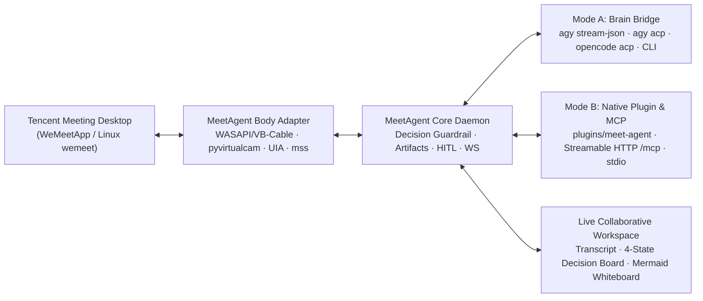

# MeetAgent — Universal Meeting Presence & Body Runtime

> **Give Antigravity, OpenCode, Claude Code, Codex, and any ACP / MCP Agent a real body inside Tencent Meeting.**

MeetAgent is a **local-first, open-source** meeting presence runtime inspired by Anthropic's Claude Meetings—re-architected around an **Agent-First Dual-Bridge** model so your existing coding & general-purpose agents can join **Tencent Meeting** as **visible participants** with full access to your local workspace, codebase, and MCP ecosystem.



## Key Features

- **Native Agent Integration (No Redundant LLM Wrapper)**
  - **Mode A (Brain Bridge)**: Automatically discovers local Agent CLIs (`agy`, `opencode`, `claude`, `codex`, `gemini`). Drives persistent multi-turn **`agy --input-format stream-json --output-format stream-json`** and universal **ACP (`agy acp` / `opencode acp`)** sessions with workspace mounting (`--add-dir`) and interactive HITL permission approval (`session/request_permission`).
  - **Mode B (Native Antigravity Plugin + MCP Server)**: Ships a strict-validated Antigravity plugin ([`plugins/meet-agent/`](./plugins/meet-agent/)) and a dual-mode MCP Server (`http://127.0.0.1:8765/mcp` Streamable HTTP + `meet-agent-mcp` stdio) so you can tell your active Antigravity / Claude Code / Cursor session: *"Join Tencent Meeting 888-999-000 and track our technical decisions."*
- **Pluggable Meeting Body (`MeetingAdapter`)**
  - **`tencent-desktop`**: Launches `WeMeetApp.exe` via `wemeet://page/inmeeting?meeting_code=...`, supports zero-install listening via **WASAPI Loopback** (`PyAudioWPatch`), optional **VB-Cable** isolated bidirectional audio, **Edge-TTS** voice output with `EchoMuteGate`, **1280×720 Live Status Tile** via `pyvirtualcam` (OBS Virtual Camera / Unity Capture), screen diff capture via `mss`, and Windows UI Automation chat/speaker helpers.
  - **`simulator`**: Built-in realistic Chinese technical review meeting simulator for instant end-to-end testing without an active call.
  - **`voov-web`**: Phase 2 Playwright extension point targeting `https://voovmeeting.com/r`.
- **Decision Guardrail (Solving the #1 Meeting AI Failure)**
  - Explicitly separates `Ideas`, `Open Questions`, `Decisions`, and `Action Items`.
  - Any proposed `Decision` lacking verbatim `evidence_quote`, explicit `decided_by`, or `confidence >= 0.75` is **automatically downgraded** to `Idea (needs_confirmation)` so brainstorming remarks are never misrecorded as final conclusions.
  - Unassigned action items are highlighted as `⚠️ 待认领` for one-click owner assignment.
- **Live Collaborative Workspace & Privacy Guardrails**
  - Real-time collaborative Markdown docs and live-rendered **Mermaid** architecture whiteboards.
  - Always joins as a visible participant, posts a transparency notice in chat, supports instant spoken/chat `"暂停记录"` / `"退出会议"`, and **never persists raw audio by default**.

## Quick Start

### 1. Backend Daemon & Environment Check

```bash
python -m venv .venv
.\.venv\Scripts\python.exe -m pip install -e ".[windows,dev]"

# Inspect local Tencent Meeting, audio/video devices, and installed Agent CLIs
.\.venv\Scripts\meet-agent.exe doctor

# Start MeetAgent Daemon (HTTP + WebSocket + Streamable HTTP MCP at /mcp)
.\.venv\Scripts\meet-agent.exe serve
```

### 2. Live Collaborative Workspace (Dev Mode)

```bash
cd web
pnpm install
pnpm dev
# Open http://127.0.0.1:5173
```

*(If you run `pnpm build` inside `web/`, `meet-agent serve` serves the compiled web UI directly on `http://127.0.0.1:8765`.)*

### 3. Install as an Antigravity Native Plugin

```bash
agy plugin validate ./plugins/meet-agent --strict
agy plugin install ./plugins/meet-agent
```

## Documentation

- [中文说明 (README.zh-CN.md)](./README.zh-CN.md)
- [Architecture Overview](./docs/architecture.md)
- [Antigravity / OpenCode / Claude Code / Cursor Integration Guide](./docs/agent-integration.md)
- [Virtual Audio (VB-Cable / PulseAudio) & Virtual Camera (OBS) Setup](./docs/virtual-devices-guide.md)

## License

MIT
